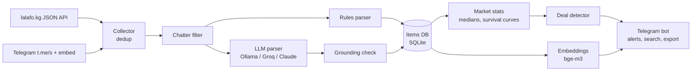

# PC Market Scanner

**Marketplace scraper with AI listing parsing and price analytics. It builds a live price database for PC hardware and sends Telegram alerts when something is listed below market.**


> Covers the whole PC hardware market of Kyrgyzstan: **lalafo.kg** (the largest classifieds site) plus public **Telegram** channels and groups.

---

## The problem

Used-hardware listings are free-form text: *"rtx3060 12g palit dual, 2 months, 23k, trade for 3070"*. One post may hold a price list of 15 items. There is no structured price data, so finding a good deal means scrolling hundreds of posts a day.

## What it does

- **Collects listings** from the lalafo.kg internal JSON API and from Telegram channels and groups through the public web view. No account or bot membership is needed, and gaps from deleted messages and albums are handled.
- **Extracts structured items with an LLM**: model, memory, condition and price as strict JSON. The **canonical model key is built by code, not by the LLM**, so "RTX3060 12G" and "GeForce RTX 3060 12GB" always map to the same model.
- **Hybrid parsing to cut AI costs**: clear-cut listings go through rules, and only messy posts reach the LLM. Chatter filtering, repost dedup, prompt caching and the Batch API (−50%) keep costs down.
- **Grounding check**: every AI answer is verified against the post text, so invented prices and models are rejected.
- **Market stats**: median, quartiles and min/max over 60 days, split by used and new, with outlier and single-seller dedup.
- **Deal detection**: alerts only when a new listing is cheaper than **every active listing** for the same model *and* the same vendor version (Palit Dual vs ROG Strix).
- **"How much can I sell it for"**: price options (fast / market / premium) with the share sold within a week, from **Kaplan–Meier survival analysis** over listing history.
- **Semantic search** with `bge-m3` embeddings: "similar listings", re-upload detection and price estimates for rare models.
- **Telegram bot UI**: search with filters (`3060 12gb up to 25k`), category browser, deals feed, watchlists, CSV export, DB backup and a one-tap update from GitHub.

## Architecture



## Tech stack

`Python 3.11` · `asyncio` · `httpx` · `BeautifulSoup4` · `aiogram 3` · `aiosqlite` · `pydantic-settings` · `numpy` · `Ollama` (local LLM + embeddings) · `Groq` · `Anthropic Claude API` (Batch API, prompt caching) · `Docker` · `pytest` (389 tests)

## Engineering highlights

- **Provider-agnostic AI layer**: switch between a free local model, Groq and Claude with one env variable. If the AI is down, the bot keeps running on rules and queues hard posts for later.
- Anti-garbage protections: implausible prices per category (a GPU for 512 som), "buying" posts and fake-cheap listings are rejected.
- Listing lifecycle tracking: price changes, bumps, sold/removed and returned. Buyer-interest metrics are collected daily.
- Privacy by design: seller phone numbers are stored **only as hashes**, enough to spot one reseller behind several accounts.

## Quick start

```bash
cp .env.example .env          # BOT_TOKEN, AI_PROVIDER, ...
docker compose up -d
```

Local development:

```bash
pip install -e ".[dev]"
pytest
python -m lalascaner
```

---

📄 Detailed user documentation (Russian): [README.ru.md](README.ru.md)

💼 Need a scraper, price monitor or AI data-extraction pipeline? **[Hire me on Upwork](https://www.upwork.com/freelancers/~01b79ffa28442df3f8)**
